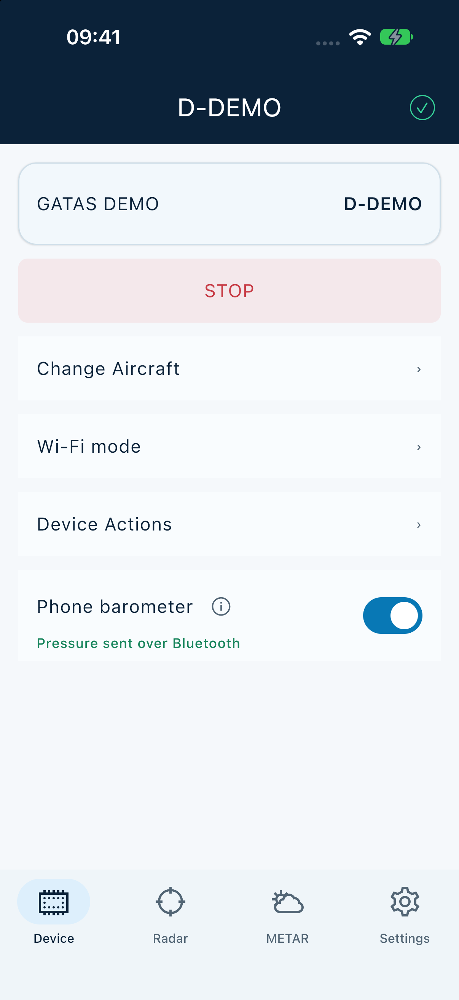
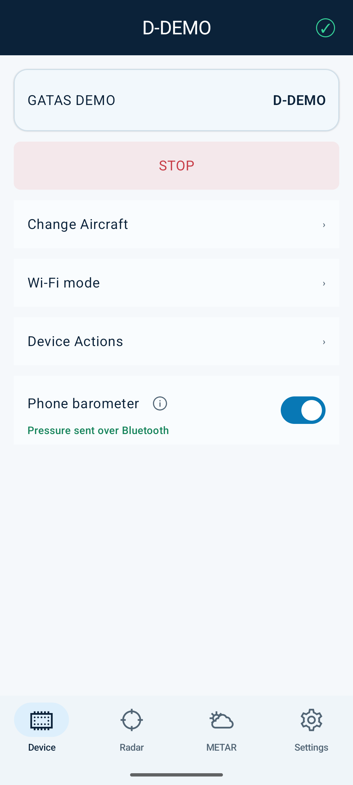
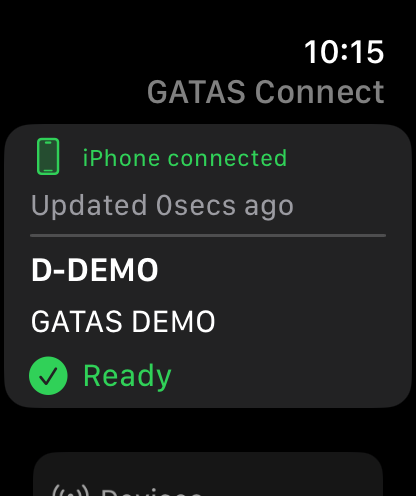
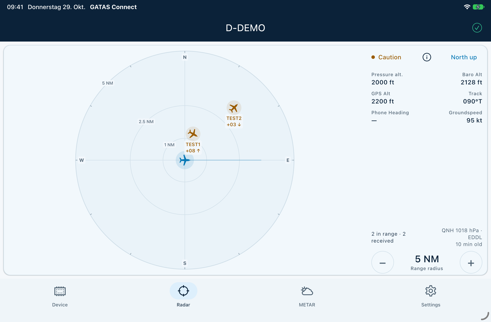
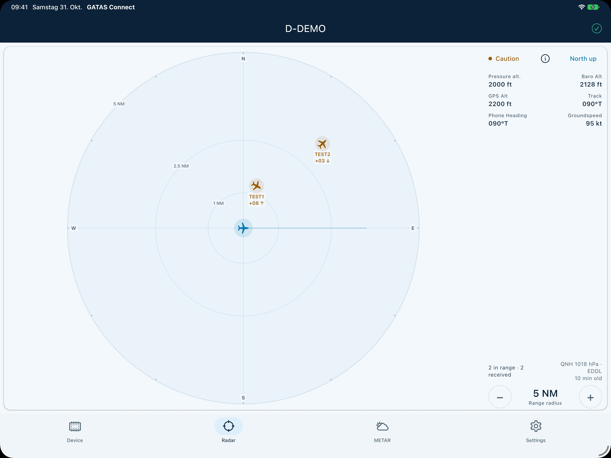
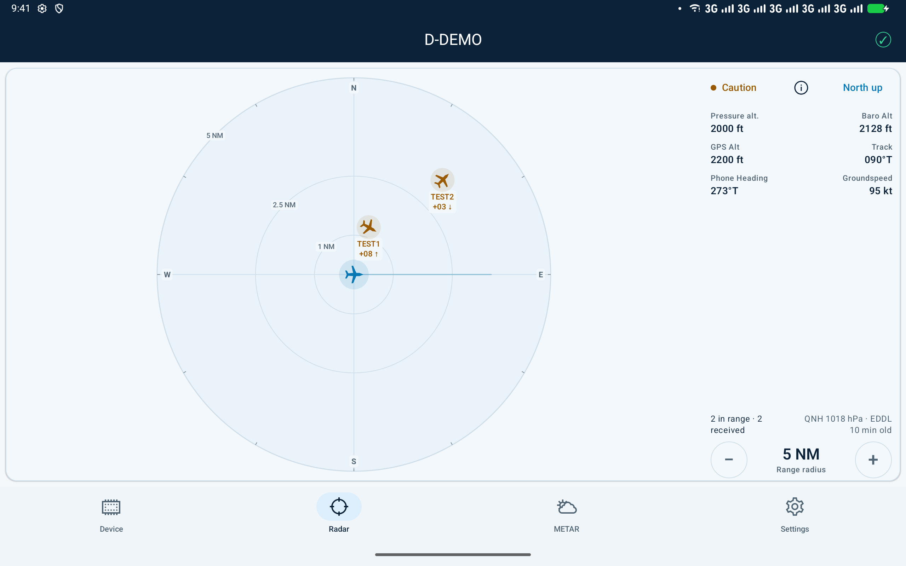

# GATAS Connect

GATAS Connect connects your phone or tablet to a GATAS device over Bluetooth.
It provides a traffic radar, METAR weather, GDL90 forwarding to compatible EFB
apps and an Apple Watch companion.

## Android downloads

[Browse Android releases](https://github.com/gatasConspicuity/gatasConnectApp/releases).
Only new releases are published here; older builds are not imported.
If the release list is empty, no Android download is available here yet.
**Pre-release** builds are for testing. A stable release will be labelled accordingly.

Android 7.0 or later is required. Download the APK attachment on your Android
device, open it and allow installation from that browser or file manager when
Android asks. Updates must use the same application ID and signing certificate.
Android does not install an older build over a newer one. Uninstalling an app
removes its local data.

## iPhone, iPad and Apple Watch

To request an invitation to the GATAS Connect TestFlight beta, contact us on
[Discord](https://discord.com/invite/J6mXTcWndS).
iOS 18 or later is required. The Watch companion requires watchOS 10 or later
and the paired iPhone app. Internal iOS build records are not published here.

## Help and feedback

- [Report a reproducible bug](https://github.com/gatasConspicuity/gatasConnectApp/issues/new/choose).
- [Ask a question](https://github.com/gatasConspicuity/gatasConnectApp/discussions/categories/q-a).
- [Suggest an improvement](https://github.com/gatasConspicuity/gatasConnectApp/discussions/categories/ideas).
- [Read announcements](https://github.com/gatasConspicuity/gatasConnectApp/discussions/categories/announcements).
- [Join the GATAS Discord community](https://discord.com/invite/J6mXTcWndS).

This repository hosts downloads, documentation and community support. The
application source code is maintained privately. GATAS firmware is a separate
[project](https://github.com/gatasConspicuity/gatas).

<!-- screenshots:start -->

## Screenshots

[Browse all screenshots](docs/SCREENSHOTS.md) · [Interactive gallery (GitHub Pages)](https://gatasConspicuity.github.io/gatasConnectApp/)

GitHub Pages must be enabled for the interactive version. The repository gallery works without hosting.

| iPhone | Android phone | Apple Watch |
| :---: | :---: | :---: |
|  |  |  |

| iPad mini | iPad 13-inch (App Store) | Android tablet |
| :---: | :---: | :---: |
|  |  |  |

Native simulator/emulator captures with synthetic demo data.

<!-- screenshots:end -->

## License and credits

GATAS Connect is proprietary software, currently free to use. See [LICENSE](LICENSE)
for the full project terms, [NOTICE](NOTICE) for project credits and
[THIRD_PARTY_NOTICES.md](THIRD_PARTY_NOTICES.md) for independent third-party terms.
The app also includes its applicable licenses and credits offline.

Traffic information can be incomplete, delayed or unavailable. GATAS is not a
certified collision warning system and does not replace visual lookout.
